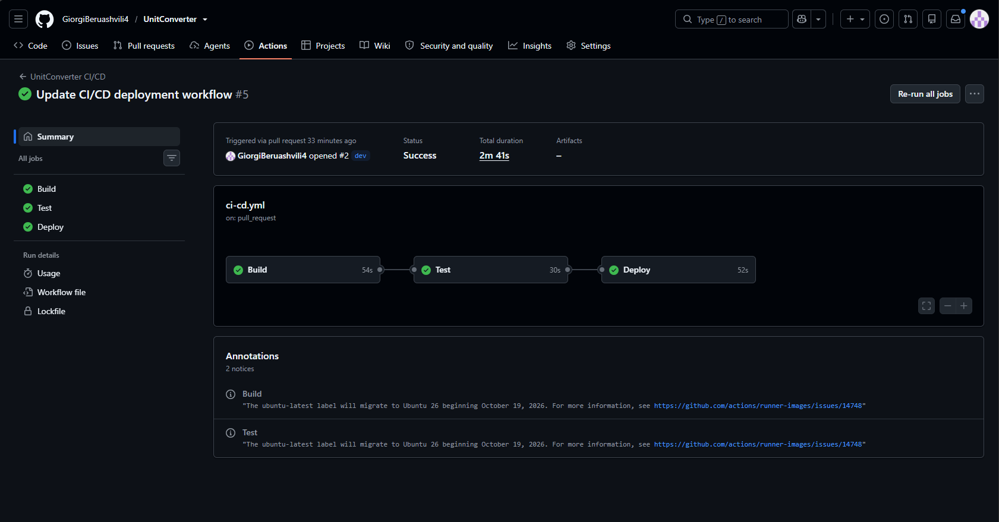
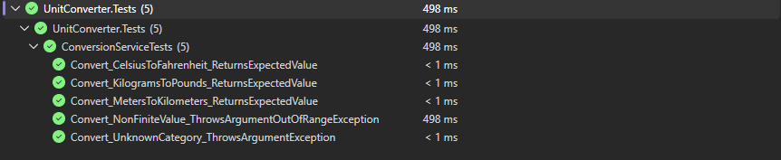
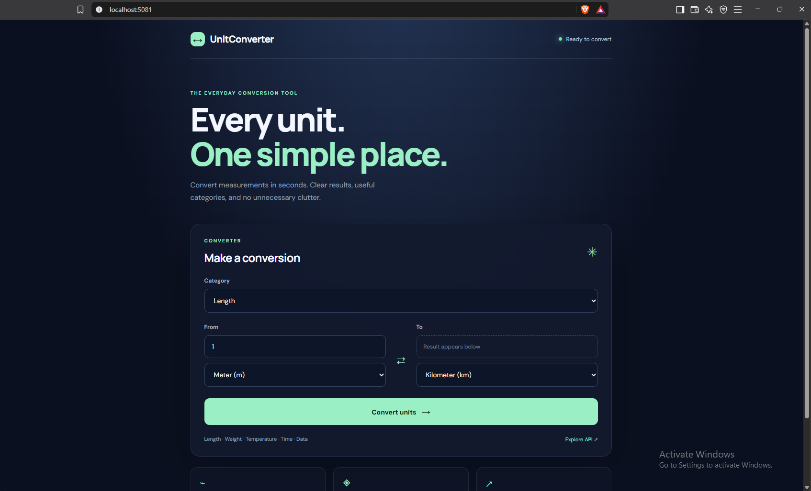
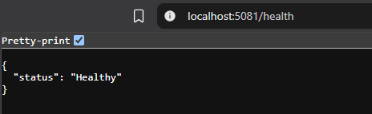
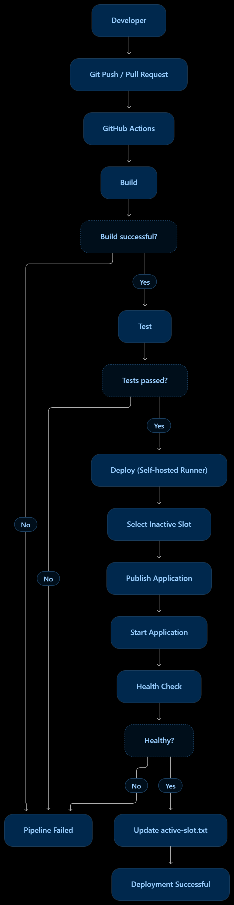

# UnitConverter

**UnitConverter** არის C# და ASP.NET Core 8-ზე შექმნილი ვებაპლიკაცია, რომელიც სხვადასხვა საზომი ერთეულების კონვერტაციის საშუალებას იძლევა.

პროექტი მოიცავს როგორც ვებინტერფეისს, ასევე API endpoint-ებს კონვერტაციის შესასრულებლად.

## ფუნქციები

- სხვადასხვა საზომი ერთეულის კონვერტაცია.
- კონვერტაციის ხუთი კატეგორიის მხარდაჭერა:
  - სიგრძე (Length)
  - წონა (Weight)
  - დრო (Time)
  - მონაცემები (Data)
  - ტემპერატურა (Temperature)
- Razor Pages-ზე დაფუძნებული ვებინტერფეისი.
- Health Check აპლიკაციის მდგომარეობის შესამოწმებლად.
- ავტომატიზებული Build, Test და Deploy პროცესები.

## გამოყენებული ტექნოლოგიები

- **C#** – პროგრამირების ძირითადი ენა.
- **.NET 8** – პროგრამული პლატფორმა.
- **ASP.NET Core** – ვებაპლიკაციისა და API-ის შესაქმნელად.
- **Razor Pages** – მომხმარებლის ინტერფეისისთვის.
- **xUnit** – ავტომატიზებული ტესტირებისთვის.
- **Git და GitHub** – ვერსიების კონტროლისა და კოდის შესანახად.
- **GitHub Actions** – CI/CD პროცესის ავტომატიზაციისთვის.
- **PowerShell** – Deployment პროცესის სამართავად.
- **Self-hosted GitHub Actions Runner** – Deployment-ის ლოკალურ Windows კომპიუტერზე შესასრულებლად.

## CI/CD პროცესი

პროექტში გამოყენებულია GitHub Actions, რომლის CI/CD Pipeline სამი ძირითადი ეტაპისგან შედგება:

**Build, Test და Deploy.**

Pipeline ავტომატურად ეშვება `main` და `dev` ბრენჩებზე Push-ის ან Pull Request-ის განხორციელებისას.

### 1. Build

ამ ეტაპზე ხდება NuGet პაკეტების აღდგენა (`restore`) და პროექტის აწყობა (`build`).

მისი მიზანია შემოწმდეს, შესაძლებელია თუ არა პროექტის წარმატებით კომპილაცია.

### 2. Test

ამ ეტაპზე სრულდება პროექტში არსებული ავტომატიზებული Unit Tests.

ტესტები ამოწმებს პროგრამის ლოგიკის სისწორეს. თუ Build ან Test ეტაპი წარუმატებლად დასრულდება, Deploy ეტაპი აღარ შესრულდება.

### 3. Deploy

Deploy ეტაპი სრულდება მხოლოდ მაშინ, როდესაც Build და Test ეტაპები წარმატებით დასრულდება.

Deployment ხორციელდება ლოკალურ Windows კომპიუტერზე, Self-hosted GitHub Actions Runner-ის გამოყენებით.

პროექტში გამოყენებულია Blue-Green Deployment მიდგომა, რომელიც ორ გარემოს მოიცავს:

- **Blue:** `C:\UnitConverter\production\blue` – პორტი `5081`.
- **Green:** `C:\UnitConverter\production\green` – პორტი `5082`.

Deployment პროცესი მოიცავს შემდეგ ნაბიჯებს:

1. განისაზღვრება ბოლოს წარმატებით გააქტიურებული გარემო `active-slot.txt` ფაილის საშუალებით.
2. შეირჩევა მეორე, არააქტიური გარემო.
3. ძველი ვერსია იშლება არჩეული გარემოდან.
4. ახალი ვერსია ქვეყნდება (`publish`) არჩეულ გარემოში.
5. აპლიკაცია ეშვება შესაბამის პორტზე.
6. მოწმდება `/health` endpoint, რათა დადასტურდეს აპლიკაციის წარმატებული გაშვება.
7. წარმატებული Health Check-ის შემდეგ ახლდება `active-slot.txt` ფაილი.

თუ Deployment ან Health Check წარუმატებლად დასრულდება, `active-slot.txt` ფაილი არ განახლდება და წინა აქტიური სლოტის მნიშვნელობა შენარჩუნდება.

## Git Workflow

პროექტში გამოყენებულია ორი ძირითადი ბრენჩი:

- `dev` – განვითარების ბრენჩი, სადაც ხდება ახალი ცვლილებების შეტანა.
- `main` – მთავარი ბრენჩი, რომელშიც ერთიანდება შემოწმებული ცვლილებები.

ახალი ცვლილებები თავდაპირველად მუშავდება `dev` ბრენჩზე, შემდეგ კი Pull Request-ის საშუალებით ერთიანდება `main` ბრენჩში.

Build და Test შემოწმებები ავტომატურად სრულდება Push-ისა და Pull Request-ის დროს. არსებული Workflow-ის კონფიგურაციით, Deploy ეტაპიც სრულდება ორივე ტიპის მოვლენაზე, თუ წინა ეტაპები წარმატებით დასრულდა.

## Screenshots & Workflow

### 1. GitHub Actions Pipeline

The GitHub Actions pipeline completed all three stages successfully: Build, Test, and Deploy.

### 2. Unit Test Results

All unit tests completed successfully, verifying the application's functionality.

### 3. Running Application

The UnitConverter application running locally in the browser.

### 4. Health Check

The health endpoint confirms that the application is running and reports a `Healthy` status.

### 5. CI/CD Workflow Diagram

A visual representation of the project's CI/CD pipeline, showing the main stages from code changes to deployment.

